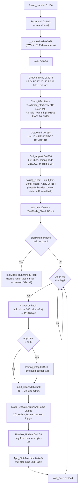
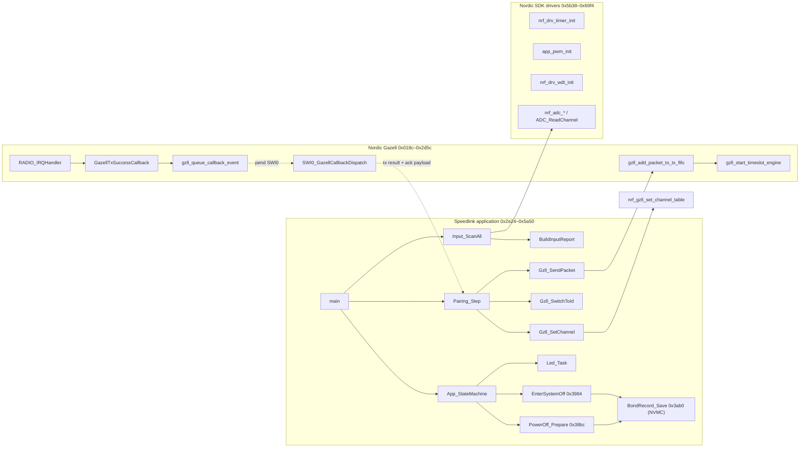
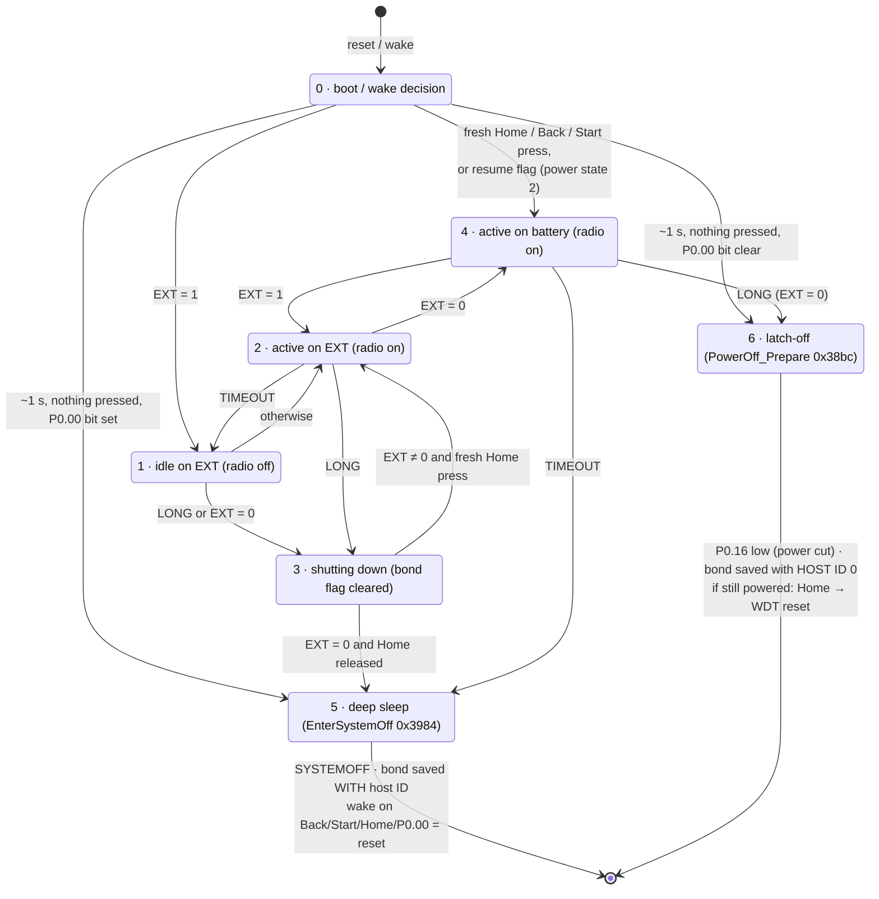
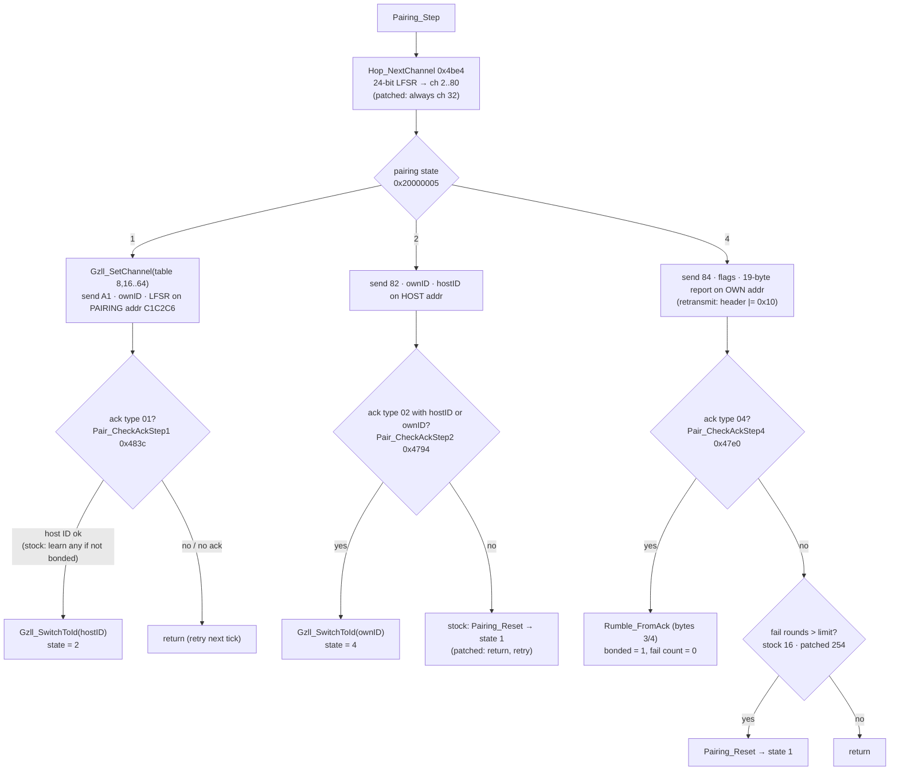
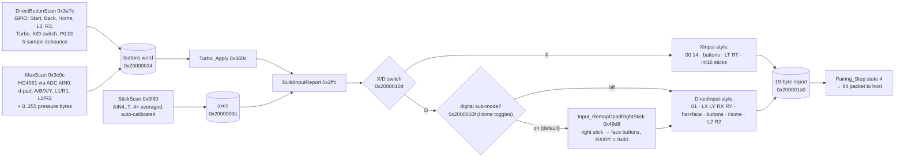

# Firmware flowcharts (stock ROM logic)

Flowcharts of the stock nRF51822 firmware, using the function names now applied in the Ghidra
project (`FIRMWARE_FUNCTIONS.md`, `tools/ghidra_names.json`). The diagrams are Mermaid (they
render on GitHub). Confidence follows the function reference. Section 3 (app power states) was
decoded by hand from the jump table at `0x4a7e` and is **medium** confidence. In particular, the
meaning of "EXT" (debounced P0.00, probably external power / charger detect) is not hardware-verified.

---

## 1. Boot and main loop

## 2. Layers (who calls whom)

## 3. App power state machine (`App_StateMachine` 0x4a54, state byte `0x20000068`)

Inputs each tick:
- **LONG** = `PowerButton_Check` (Home held > ~3.3 s)
- **TIMEOUT** = `IdleTimer_Check` (pairing ~36 s / idle ~8 min)
- **EXT** = `P0_00_Debounce_maybe` (debounced P0.00, probably external power)

`Pairing_Step` (the radio) only runs in states **2** and **4**.

> ⚠️ **Locked-image consequence.** On battery, **holding Home to switch off (state 4 → 6)** saves
> **host ID 0**. Stock firmware is fine with that: it re-learns any host on the next pairing (the stock
> dump has host 0 for exactly this reason). The strict lock (`0x4860`/`0x4866` NOPs) is not: after
> such a power-off the controller rejects the Nano until it is reflashed. Fixes, both untested:
> - NOP `bl BondRecord_Save` at `0x3908` (`00 bf 00 bf`).
> - Build with `--soft`. The controller then re-learns `ABCDEF` from the Nano.

## 4. Pairing / streaming (`Pairing_Step` 0x4514, one packet per call)

## 5. Input → report pipeline (`Input_ScanAll` 0x4bb0, every tick)

